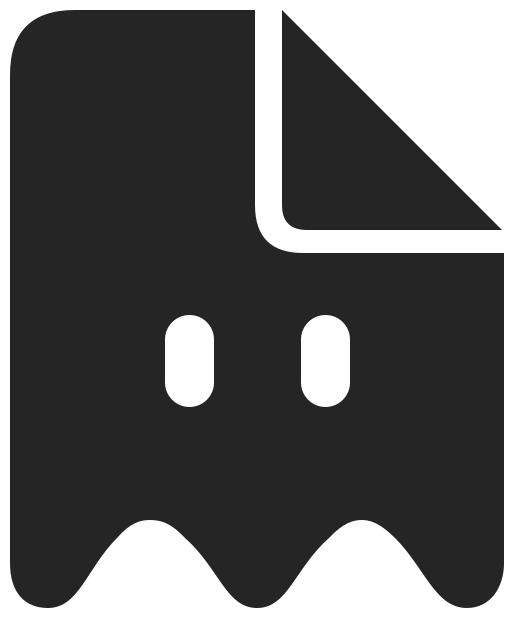

<p align="center">
  <picture>
    <source media="(prefers-color-scheme: dark)" srcset="assets/brand/skul-mark-dark.svg" />
    
  </picture>
</p>

<h1 align="center">skul</h1>

<p align="center">
  <strong>Your AI setup, kept out of Git.</strong><br />
  Apply shared skills, subagents, instructions, and MCP servers to 12 coding tools — without a single line in <code>git status</code>.
</p>

---

Every AI coding tool wants its own dotdir: `.claude/`, `.cursor/`, `.codex/`, `.kiro/`… Committing them pollutes the repo and your teammates' tool choices. Copying them between projects drifts.

Skul keeps one bundle in a Git repo (or npm package), writes it where each tool expects it, and hides the result with `.git/info/exclude`.

```bash
npm install --global @solaqua/skul

skul add sjquant/ghosts writing    # fetch a public example, write, hide
skul status                        # what's applied, where
skul apply                         # same setup in a new worktree
skul remove writing                # remove it, restore your originals
```

## Why

**More than skills.** Subagents, commands, `AGENTS.md` / `CLAUDE.md`, and MCP servers go in the same bundle, and Skul translates each into every tool's own layout and dialect. Install per project, or globally with `--global`.

**Nothing to commit.** Files are hidden through `.git/info/exclude`, never `.gitignore`. Even a team-committed `AGENTS.md` can take your own layer on top with no diff.

**Undo anytime.** Skul tracks what it wrote. Remove a bundle, or `skul reset`, and your original files come back.

## Works with

Claude Code · Cursor · Codex · OpenCode · GitHub Copilot · Kiro · Antigravity · Grok Build · Qwen Code · Cline · Kimi Code CLI · ZCode

## Learn more

- [Getting started](https://skul.solaqua.dev/docs/intro) — install and apply your first bundle
- [How it stays out of Git](https://skul.solaqua.dev/docs/how-it-works) — exclude, shadows, and the registry
- [Writing a bundle](https://skul.solaqua.dev/docs/bundles) — layout, manifest, MCP servers, cross-repo references
- [Commands](https://skul.solaqua.dev/docs/commands) and [supported tools](https://skul.solaqua.dev/docs/tools)

Requires Node.js 20+ and Git. [ISC licensed](LICENSE).
